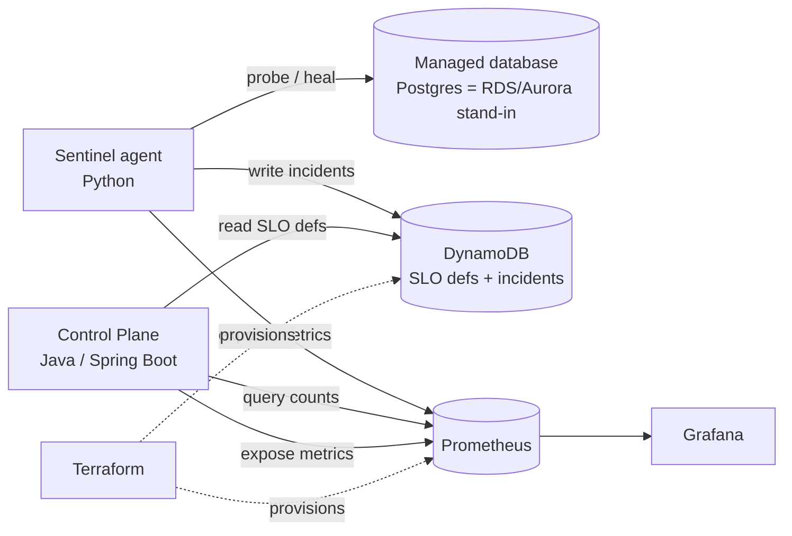

# Architecture

## System context



## The control loop (the heart of the platform)

```mermaid
sequenceDiagram
    autonumber
    participant loop as Sentinel loop
    participant db as Database
    participant ml as Anomaly detector
    participant heal as Healing engine
    participant dyn as DynamoDB
    participant met as Metrics

    loop over every interval
        loop->>db: probe (connections, idle-in-txn, lag, latency)
        db-->>loop: HealthSample
        loop->>met: export signals
        loop->>ml: observe(features)
        ml-->>loop: is_anomaly, score
        loop->>heal: evaluate(sample)
        alt a rule fires
            heal-->>loop: Action
            loop->>dyn: open incident
            loop->>db: apply action (e.g. terminate idle sessions)
            loop->>met: record healing action
        else healthy
            loop->>dyn: resolve any open incident (record MTTR)
        end
    end
```

## How each JD requirement maps to the code

| Requirement | Where it lives |
|---|---|
| Self-healing automation | `sentinel/healing.py` (rules + actions), driven by `sentinel/main.py` |
| Production code in Python **and** Java | Python agent (`sentinel/`) + Java control plane (`control-plane/`) |
| Own SLOs & error budgets | `control-plane/.../slo/` — `ErrorBudget.compute`, `SloService`, `SloController` |
| Monitoring, alerting, diagnostics | Prometheus + Grafana (`infra/`), CloudWatch alarms (`infra/terraform/cloudwatch.tf`) |
| AWS managed services (DynamoDB, CloudWatch) | `sentinel/aws.py` (boto3), `control-plane/.../DynamoDbSloRepository.java` (AWS SDK v2) |
| AI/ML in the design | `sentinel/anomaly.py` — Isolation Forest |
| Infrastructure as code | `infra/terraform/` — DynamoDB tables, CloudWatch alarms, SLO seeds |
| Resilient services, SLOs, error budgets, MTTR | error-budget model + `dbs_mttr_seconds` metric |
| CI/CD | `.github/workflows/ci.yml` |
| Observability tooling (Prometheus/Grafana) | `infra/prometheus`, `infra/grafana` |

## Consistency & safety model

- **Healing is conservative:** first-match-wins rules; actions only terminate demonstrably-safe sessions; an `HEALING_ENABLED=false` observe-only mode; every action is a metric.
- **ML raises severity, never acts alone:** an anomaly flag escalates an incident but destructive remediation only ever comes from an explicit rule.
- **Infra boundary:** Terraform creates resources; applications only read/write items. Apps never create infrastructure.
